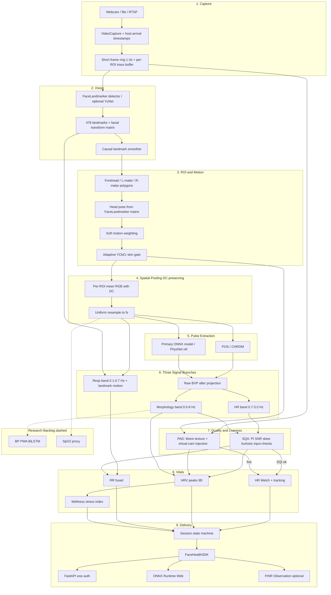
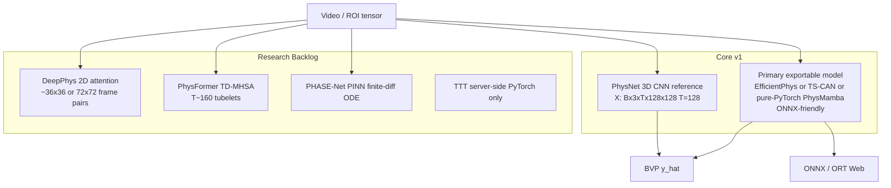
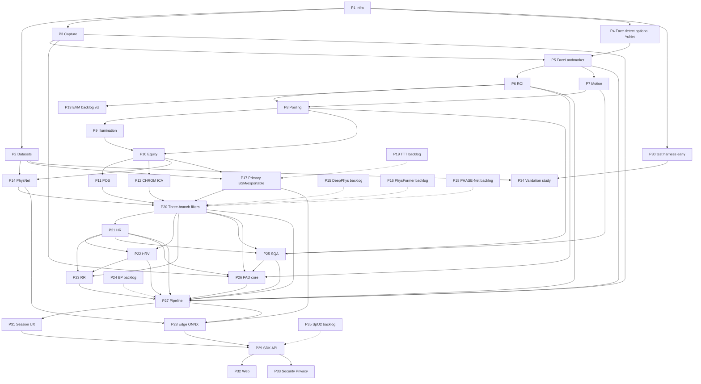
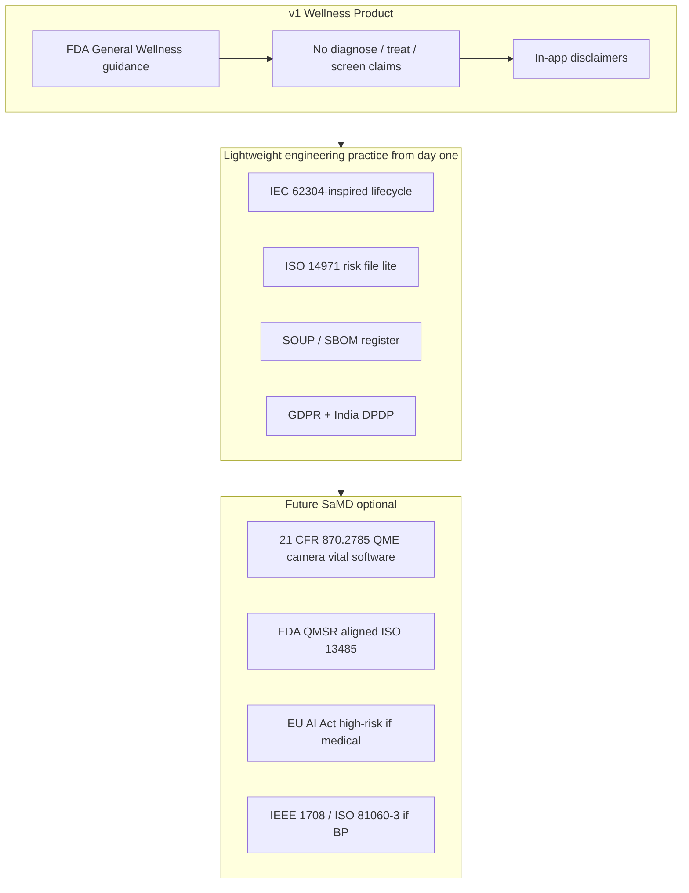

# Contactless rPPG Vital Sign Monitoring System: Master Engineering Plan
## FaceHealth-rPPG v2.0 — Wellness-First Commercial Architecture

---

### Document Control & Metadata
- **Document Version:** 2.0.0
- **Project Codename:** `FaceHealth-rPPG`
- **Intended Use (v1):** General wellness / fitness self-assessment. **No diagnostic, screening, or treatment claims.** SaMD pathway documented for a future release (Section 9).
- **Target Regulatory Context (later SaMD):** FDA General Wellness guidance → optional future 510(k) under 21 CFR 870.2785 (QME) / related; IEC 62304 Class B practices (lightweight from day one); ISO 14971 risk file; IEEE 1708 / ISO 81060-3 for any future cuffless BP (Research Backlog only).
- **Primary Operational Environments:** Python 3.12 desktop/server (Windows/Linux) + Web (ONNX Runtime Web / MediaPipe Tasks JS). Native mobile, CoreML, and C++ core are **out of v1 scope**.
- **Core Wellness Targets (v1):** Heart Rate (HR / pulse rate), Heart Rate Variability (time-domain: SDNN, RMSSD, pNN50), Respiration Rate (RR), Wellness Stress Index (Baevsky-derived, non-clinical label), Signal Quality Assessment (SQA), Basic Presentation Attack Detection (PAD).
- **Research Backlog (feature-flagged, no product claims):** Cuffless Blood Pressure (SBP/DBP), SpO2 proxy, PHASE-Net, TTT, DeepPhys, PhysFormer, EVM (visualization only), advanced PAD (deepfake / 3D masks).
- **Hardware Assumption:** Dev on NVIDIA RTX 3050 Laptop (4 GB VRAM); training on cloud GPU.
- **Changelog from v1.0:** Fixed signal-branch architecture (DC preservation + 3 filter bands); corrected dataset facts; replaced AGPL YOLO with MediaPipe/YuNet; unified latency/memory definitions; wellness regulatory rewrite; milestones M0–M6; Phases 31–35 added. See [`tasks/todo.md`](tasks/todo.md).

---

## 1. Executive Summary & Clinical/Commercial Architecture

### 1.1 Commercial & Technical Benchmarking

Competitor figures below are **unverified public/marketing estimates** (not independently measured). Use them for orientation only. FaceHealth targets are split into **Release Gate** (ship bar after M2 baseline reproduction) and **Stretch** (aspirational).

| Metric / Parameter | Traditional rPPG (2014–2018) | Competitor Est. (unverified) | **Release Gate** | **Stretch** |
| :--- | :--- | :--- | :--- | :--- |
| **Heart Rate MAE** | 3.5 – 6.0 BPM | Shen.ai ~1.5 / FaceHeart ~1.8 | ≤ 2.5 BPM (UBFC), ≤ 4.0 BPM (PURE motion), ≤ 5.0 BPM (MMPD) | ≤ 1.2 / 2.0 / 2.5 BPM |
| **HRV RMSSD MAE** | > 25 ms | ~8–10 ms | ≤ 15 ms (stationary, ≥60 s window) | ≤ 6.5 ms |
| **Respiration Rate MAE** | 3.0 – 4.5 RPM | ~1.8–2.0 RPM | ≤ 2.5 RPM on COHFACE / in-house belt | ≤ 1.5 RPM |
| **Blood Pressure** | Uncalibrated | FaceHeart claims ISO-class (unverified for cuffless) | **Out of v1** (Research Backlog) | IEEE 1708 / ISO 81060-3 when pursued |
| **Skin Tone Equity** | Biased I–II | Partial ITA | Stratified reporting; ΔMAE(III→VI) tracked on MMPD; I–II via in-house | ΔMAE < 0.8 BPM across full MST |
| **Per-frame vision latency** | 45 – 100 ms | ~12–15 ms | ≤ 33 ms (CPU) to sustain 30 FPS; ≤ 15 ms (GPU) | ≤ 10 ms GPU / ≤ 25 ms CPU |
| **PAD** | None | Active/passive ensembles | Texture/Moiré + virtual-camera injection gate | Full ISO/IEC 30107-3 lab eval |

**Latency definition:** "Per-frame vision latency" = capture enqueue → landmarks + ROI mask ready. "Model window latency" = DL forward on a T-frame chunk (reported separately). Do not conflate the two.

**FaceHeart FDA clearances (verified):** K223622 (pulse/HR SDK, 2023), K243966 (RR SDK, 2025). Prior plan citation **K223847 was incorrect**.

### 1.2 Optical & Hemodynamic Principles
When the left ventricle contracts during cardiac systole, a pressure wave travels through the vascular tree, causing instantaneous expansion of arterial capillaries within the facial dermis. Hemoglobin ($HbO_2$ and $Hb$) exhibits a localized optical absorption peak in the green spectrum ($\lambda \approx 520 - 580\text{ nm}$).

Under ambient illumination, reflected light intensity $I(t)$ received by an RGB camera is decomposed via the Shafer Dichromatic Reflection Model:

$$I(t) = I_d(t) + I_s(t) = v_d(t) \cdot s(t) + v_s(t) \cdot m(t)$$

Where:
- $I_d(t)$ is diffuse reflectance bearing pulsatile hemodynamic information $s(t)$.
- $I_s(t)$ is specular (interface) reflectance modulated by motion/geometry $m(t)$.
- The pulsatile AC component is typically **0.5%–2.0%** of DC amplitude → spatial averaging over $N \ge 10^3$–$10^4$ skin pixels (distance-aware), motion compensation, and careful filter-band design are mandatory.

**Critical v2 design rule:** Classical POS/CHROM require **DC-preserving** per-channel means. Subtractive detrending or z-scoring **before** projection destroys the relative color amplitudes these algorithms rely on. Detrend the BVP **after** projection (see Section 2).

### 1.3 Scope, Tiers & Key Decisions

| Decision | v2 Choice | Rationale |
| :--- | :--- | :--- |
| Intended use | Wellness first | Avoids premature SaMD burden; still practices lightweight IEC 62304 / ISO 14971 |
| Commercial | Yes | Drop AGPL Ultralytics YOLO; prefer Apache/BSD MediaPipe + OpenCV YuNet |
| Platforms | Python + Web | Matches team capacity; mobile/C++ deferred |
| DL strategy | 1 exportable primary + PhysNet reference | 4 GB VRAM + ONNX/Web exportability |
| BP / SpO2 | Research Backlog | Highest clinical/regulatory risk; wellness cannot claim them |
| Python | 3.12 (matches existing `.venv`) | Avoid dual environments |
| Compute | Local 3050 + cloud train | Mixed precision / small batches locally |

**Tier tags used on every phase:** `Tier: Core v1` | `Tier: Research Backlog`  
**Milestone tags:** `M0` … `M6` (build order; not phase-number order).

---

## 2. High-Level System Architecture



---

## 3. Signal Processing Flow & Mathematical Formulations


### Detailed Mathematical Model
1. **Spatial pooling (DC preserved):**
   $$\bar{C}_k(t) = \frac{1}{N_{ROI}(t)} \sum_{i \in \Omega} C_k^{(i)}(t), \quad k \in \{R,G,B\}$$
   Ideal independent-noise SNR gain is $10\log_{10}(N)$ dB; real webcam noise is correlated (demosaic/compression). **Verification uses measured ΔSNR vs single-pixel baseline**, not the theoretical 44 dB figure.

2. **POS (requires DC):**
   $$c_n = \frac{\bar{C}}{\mu_L} - 1,\quad S_1=g_n-b_n,\quad S_2=g_n+b_n-2r_n,\quad h=S_1+\frac{\sigma(S_1)}{\sigma(S_2)}S_2$$
   After OLA, **remove window means before overlap-add**, then apply Tarvainen detrending on $H(t)$.

3. **CHROM:**
   $$X=3r_n-2g_n,\quad Y=1.5r_n+g_n-1.5b_n,\quad S_{CHROM}=X-\frac{\sigma(X)}{\sigma(Y)}Y$$

4. **Three post-extraction bands (config keys):**
   - `signal.hr_band_hz: [0.7, 3.0]` → 42–180 BPM (HR, spectral SNR)
   - `signal.morph_band_hz: [0.5, 8.0]` → peaks, HRV, SQI moments, future BP morphology
   - `signal.resp_band_hz: [0.1, 0.7]` → 6–42 RPM (+ landmark vertical motion channel)

5. **Unified HR plausibility:** PAD and HRV use the same band (mapped to BPM / NN ms). Extended exercise/pediatric modes are config overrides, not hard-coded elsewhere.

---

## 4. Deep Learning Architecture Taxonomy



**PhysFormer note (v2 correction):** The published PhysFormer (Yu et al., CVPR 2022) builds Q/K via temporal-difference convolution with temperature scaling — **not** a free-form $\Delta K$ term as written in v1. Re-implement from the paper + official code if pursued in backlog.

**PHASE-Net note:** Discrete BVP sequences must use **finite differences** for temporal derivatives (not `autograd` w.r.t. time unless $t$ is an input). Full 1D Navier-Stokes spatial terms are not observable from face video; prefer constrained oscillator / spectral priors.

**Primary model selection (M4):** Choose one of EfficientPhys / TS-CAN / FactorizePhys / pure-PyTorch selective-scan PhysMamba after M2 classical baselines. Must export to ONNX. Custom CUDA `mamba-ssm` is **WSL2/Linux training only** and is **not** the production path.

---

## 5. Comprehensive Technology Stack

| Layer | Primary | Fallback | Notes |
| :--- | :--- | :--- | :--- |
| **Runtime** | Python 3.12 | — | Matches existing `.venv` |
| **DL** | PyTorch 2.x + CUDA | ONNX Runtime | Cloud train; local AMP |
| **Face / landmarks** | MediaPipe Tasks FaceLandmarker (Apache-2.0) | OpenCV YuNet (optional multi-face) | **No Ultralytics (AGPL)** |
| **CV** | `opencv-python` (dev HUD) | `opencv-python-headless` (server) | **One OpenCV install per env** |
| **Signal** | scipy, numpy, PyWavelets | NeuroKit2 (peaks) | Shared filter module |
| **Config** | Pydantic v2 (runtime/SDK) | Hydra (training only) | Do not dual-configure |
| **Lint / types** | ruff + mypy | — | mypy overrides for mediapipe |
| **Packaging** | uv lock / pip-tools | — | Pin after resolve on 3.12 |
| **Tracking** | MLflow | W&B | + DVC for datasets |
| **API** | FastAPI + Uvicorn | — | `wss://` + auth + rate limit |
| **Web** | ONNX Runtime Web + MediaPipe Tasks JS | — | Phase 32 |
| **Test** | pytest + Hypothesis | — | Fixtures under `tests/fixtures/` |

**License / SOUP (Phase 1.7):** Maintain a third-party component register. rPPG-Toolbox uses a **Responsible AI Source Code License** (not MIT/Apache) — fine for internal benchmarking; **do not ship its code** in a commercial binary without legal review. MMPD / COHFACE / FaceForensics++ are research/non-commercial — training weights for product must use commercially licensed or in-house data (Phase 34).

---

## 6. Global Phase Dependency Graph



### 6.1 Milestones (build order)

| Milestone | Goal | Phases (primary) |
| :--- | :--- | :--- |
| **M0 Foundation** | Env, licenses, CI, dataset access requests, intended-use ADR | P1, P30 harness bootstrap, P33 threat-model draft |
| **M1 Minimal E2E HR** | Webcam → FaceLandmarker → ROI → POS → HR on HUD | P3, P5, P6 (basic), P8, P11, P20 (HR branch), P21, P25 (minimal), P27 (minimal) |
| **M2 Robustness** | Motion, illumination ablations, equity, classical suite, full SQA | P7, P9, P10, P12, P20 (all branches), P25 |
| **M3 More vitals** | HRV, RR, wellness stress; min durations | P22, P23; P34 starts |
| **M4 Deep learning** | PhysNet ref + one ONNX primary | P14, P17, P28 (export) |
| **M5 Productization** | Session UX, SDK, Web, security | P31, P29, P32, P33, P28 polish |
| **M6 Research backlog** | BP, SpO2, advanced PAD, extra DL, EVM viz | P13, P15, P16, P18, P19, P24, P26-advanced, P35 |


---

## 7. Exhaustive Phase-by-Phase Master Engineering Specifications

---

### PHASE 1: Project Infrastructure & Environment Setup
- **Tier:** Core v1 | **Milestone:** M0
- **Objective:** Deterministic Python 3.12 environment, package layout, CI, license/SOUP register, logging, config.
- **Dependencies:** None.

#### Sub-Phases & Task Checklist
- [ ] **1.1 Python 3.12 Environment & Locked Deps:** Use existing `.venv` (3.12.8). Resolve pins with `uv` or `pip-tools` for torch (CUDA), opencv-python, mediapipe, scipy, onnxruntime. Document cloud-train extras separately.
- [ ] **1.2 Directory Skeleton (`src/facehealth/` package):**
```text
c:\Users\Manas\Desktop\Face_health\
├── configs/
├── data/{raw,processed,ground_truth}/
├── docs/{plans,adr}/
├── models/{checkpoints,onnx}/
├── notebooks/
├── scripts/
├── src/facehealth/
│   ├── capture/
│   ├── classical/
│   ├── deep_learning/
│   ├── detection/
│   ├── edge/
│   ├── evaluation/
│   ├── landmarks/
│   ├── liveness/
│   ├── preprocessing/
│   ├── quality/
│   ├── roi/
│   ├── signal_extraction/
│   ├── vital_estimation/
│   ├── api/
│   └── utils/
├── tests/{unit,integration,fixtures}/
├── .github/workflows/
├── Dockerfile
├── pyproject.toml
└── requirements.txt
```
- [ ] **1.3 Git Ignore & Pre-commit:** `.gitignore` excludes `.venv/`, `data/raw/`, `models/checkpoints/`, `.env`, secrets. Hooks: ruff, mypy (non-strict globally + per-module overrides).
- [ ] **1.4 Structured Logging:** `facehealth.utils.logger` via loguru; microsecond timestamps; rotation; **never log raw frames or PII**.
- [ ] **1.5 Config Engine:** Pydantic v2 models for runtime; Hydra only for training experiments.
- [ ] **1.6 CI Bootstrap:** GitHub Actions: lint, typecheck, CPU unit tests, tiny fixture regression.
- [ ] **1.7 License & SOUP Review:** Register every dependency license; ban AGPL in product path; document dataset commercial status.
- [ ] **1.8 Experiment & Data Versioning:** MLflow + DVC (or equivalent); model cards template.

#### Deliverables
1. `requirements.txt` / lockfile  
2. `pyproject.toml`  
3. `configs/config.yaml`  
4. `src/facehealth/utils/logger.py`  
5. `src/facehealth/utils/config_manager.py`  
6. `docs/soup_register.md`  
7. `.github/workflows/ci.yml`

#### Verification Criteria
- `pytest --version` works in `.venv`.
- Imports: `torch`, `cv2`, `mediapipe`, `scipy` without DLL errors.
- mypy passes with documented overrides (zero unexplained errors).
- CI green on a trivial test.

---

### PHASE 2: Dataset Acquisition & Data Pipeline Architecture
- **Tier:** Core v1 | **Milestone:** M0–M1
- **Objective:** Ingest, standardize, and split benchmark datasets with honest ground-truth mapping and license tracking.
- **Dependencies:** Phase 1.

#### Dataset Registry (verified facts)

| Dataset | Videos / Subjects | Camera | Ground Truth | Skin / Notes | License / Access | Serves Phases |
| :--- | :--- | :--- | :--- | :--- | :--- | :--- |
| **UBFC-rPPG** (DATASET_2) | **42** shared videos (of 46) | **Logitech C920** 640×480 @ 30 FPS | CMS50E PPG + HR | Limited diversity | Research request | P11–P14, P21, P30 |
| **PURE** | 60 seq / 10 subj / 6 motions | eco274CVGE 640×480 @ 30 | CMS50E PPG + **SpO2** @ 60 Hz | **No respiration belt** | Research | P12, P21, P30 (not RR) |
| **MMPD** | 660×1 min / 33 subj | Phone → 320×240 | HKG-07C+ PPG | **Fitzpatrick 3–6 only** (16/5/6/6) | **Academic, no commercial** | P10 equity, P16/P19 research |
| **COHFACE** | 160×1 min / 40 subj | C525 @ 20 FPS | BVP + **respiration belt** | — | Research (Idiap) | **P23 RR** |
| **UBFC-Phys** | Stress tasks | — | BVP + EDA | — | Research | P22 stress wellness |
| **WIDER FACE** | Images | — | Face boxes | — | Research | P4 optional YuNet eval |
| **In-house (P34)** | TBD | Multiple webcams | ECG / belt / cuff | Full MST + age/sex | Commercial-owned | Product weights, BP/SpO2 later |

**Do not claim:** UBFC = 43 videos or "industrial uEye"; MMPD = Fitzpatrick I–VI; PURE for RR GT; MIMIC-III as face-video BP validation.

#### Sub-Phases
- [ ] **2.1 Access Tracker:** Request forms for UBFC, PURE, MMPD, COHFACE; record approval dates in `task_plan.md`.
- [ ] **2.2 Checksums & Layout:** SHA-256 where provided; demux to memmap/HDF5.
- [ ] **2.3 Temporal Alignment:** Use **dataset timestamps / fixed per-dataset offsets**. **Forbidden:** cross-correlating GT against the rPPG method under test (optimistic bias).
- [ ] **2.4 Subject-Independent Splits:** Subject-wise k-fold (preferred) or 70/15/15 with **zero subject overlap**. Also define cross-dataset protocols (e.g., train PURE → test UBFC).
- [ ] **2.5 PyTorch DataLoader:** Chunks T=128/256; `num_workers` tuned for Windows; pin_memory when CUDA available.
- [ ] **2.6 Metrics Protocol:** Report subject-level and window-level MAE/RMSE/r with bootstrap CIs.

#### Deliverables
1. `src/facehealth/preprocessing/data_loader.py`  
2. `src/facehealth/preprocessing/dataset_aligner.py`  
3. `scripts/download_datasets.py` (only for datasets that allow automation)  
4. `configs/dataset_config.yaml` + `docs/dataset_registry.md`

#### Verification Criteria
- Sync error vs dataset clock < 5 ms where timestamps exist.
- Subject overlap Train/Val/Test = 0%.
- Registry documents commercial vs research-only for every source.

---

### PHASE 3: Camera Capture & Video Acquisition Module
- **Tier:** Core v1 | **Milestone:** M1
- **Objective:** Threaded capture with bounded memory and honest timestamps.
- **Dependencies:** Phase 1.

#### Sub-Phases
- [ ] **3.1 UVC Ingestion:** DirectShow/MSMF on Windows; V4L2 on Linux. Probe which exposure/WB/power-line controls exist (**backend-specific**; do not hard-code V4L2 `0.25` semantics on DSHOW).
- [ ] **3.2 Bounded Buffers:** Keep **1–3 s** of full frames for vision. Persist long history as **per-ROI RGB traces** (KB-scale), not 30–60 s of 640×480 frames (~0.8–1.7 GB).
- [ ] **3.3 Host-Arrival Timestamps:** `time.perf_counter_ns()` = host arrival, **not** sensor hardware time. Measure jitter; do not require σ < 1.5 ms as a hard gate on USB webcams.
- [ ] **3.4 Offline Feeder:** Replay UBFC/PURE/COHFACE at real-time or max-speed for tests.
- [ ] **3.5 Producer Thread:** Dedicated capture thread; mutex/queue (do **not** claim lock-free under CPython GIL).
- [ ] **3.6 Variable FPS:** Negotiate FPS; handle 15 FPS low-light and VFR phone files (MMPD).

#### Deliverables
1. `src/facehealth/capture/video_capture.py`  
2. `src/facehealth/capture/frame_buffer.py`  
3. `tests/unit/test_capture.py`

#### Verification Criteria
- Sustained ≥ 25–30 FPS when camera delivers it; dropped-frame counter exposed.
- Ring buffer RSS contribution < 50 MB for 640×480×3 × 90 frames.
- No unbounded growth over 10-minute soak.

---

### PHASE 4: Face Detection (Optional YuNet) — No AGPL YOLO
- **Tier:** Core v1 (optional path) | **Milestone:** M1
- **Objective:** Multi-face / far-field detection when FaceLandmarker's built-in detector is insufficient. **Ultralytics YOLOv8 removed (AGPL-3.0 incompatible with commercial closed distribution).**
- **Dependencies:** Phase 1, Phase 3.

#### Sub-Phases
- [ ] **4.1 Default Path:** Prefer MediaPipe FaceLandmarker end-to-end (Phase 5) — detector + landmarks + transform matrix.
- [ ] **4.2 Optional YuNet:** OpenCV Zoo YuNet ONNX for multi-face or distant faces; IoU/Kalman track IDs.
- [ ] **4.3 Primary Subject Policy:** Largest face nearest optical axis.
- [ ] **4.4 WIDER FACE Spot-Check:** Optional mAP sanity (research weights); not a product blocker.

#### Deliverables
1. `src/facehealth/detection/face_detector.py` (YuNet optional wrapper)  
2. `models/onnx/yunet.onnx` (if used)  
3. `tests/unit/test_face_detector.py`

#### Verification Criteria
- Optional path latency budget fits inside 33 ms/frame CPU envelope with landmarks.
- Default M1 path works with **zero** YOLO/Ultralytics dependency.

---

### PHASE 5: Dense Facial Landmarking (MediaPipe FaceLandmarker)
- **Tier:** Core v1 | **Milestone:** M1
- **Objective:** 478-landmark FaceLandmarker with blendshapes + facial transformation matrix; causal smoothing.
- **Dependencies:** Phase 3 (Phase 4 optional).

#### Sub-Phases
- [ ] **5.1 FaceLandmarker Integration:** MediaPipe Tasks API (legacy `mp.solutions.face_mesh` deprecated).
- [ ] **5.2 Metric / IPD Normalization:** Use iris landmarks **468/473 only when refine/478 mode enabled**; otherwise use eye-corner proxies. Document index map in config.
- [ ] **5.3 Causal Smoothing:** One Euro filter or velocity-adaptive EMA (**no non-causal Gaussian σ=3** that adds ~0.3 s delay).
- [ ] **5.4 ROI Index Map:** Forehead / L-malar / R-malar / exclusions. **Visually verify** indices (v1 lists mixed eyebrow/chin points). Prefer published pyVHR-style maps after license check.
- [ ] **5.5 Presence Score Gate:** MediaPipe does not give per-landmark confidence; gate on face presence / tracking score, not fictional τ=0.85 per point.
- [ ] **5.6 Head Pose:** Prefer FaceLandmarker facial transformation matrix over solvePnP+guessed intrinsics.

#### Deliverables
1. `src/facehealth/landmarks/landmark_detector.py`  
2. `configs/landmark_config.yaml`  
3. `tests/unit/test_landmarks.py`

#### Verification Criteria
- Stationary jitter σ_p < 0.5 px after smoothing (measure; tune).
- Landmark+detect path < 12 ms CPU typical on laptop.

---

### PHASE 6: Granular ROI Extraction & Dynamic Masking
- **Tier:** Core v1 | **Milestone:** M1–M2
- **Objective:** Forehead + bilateral malar masks with adaptive skin gating; distance-aware pixel targets.
- **Dependencies:** Phase 5.

#### Sub-Phases
- [ ] **6.1 Polygon Fill:** `cv2.fillPoly` (not convex-only) from verified landmark indices.
- [ ] **6.2 Exclusion Zones:** Dilate eyes/lips; measure leakage % (replace impossible "100% blink exclusion" — eyes are not in ROIs).
- [ ] **6.3 Adaptive Skin Model:** Fit per-subject YCbCr Gaussian on ROI core; **avoid fixed HSV thresholds** that bias dark skin / colored light.
- [ ] **6.4 Distance-Aware Targets:** At 640×480 @ ~1 m, face width ~70 px → total face ~6k px. Require 720p/1080p **or** scale minimum skin pixels with IPD. Example gate: $N_{skin} \ge \max(2000, f(IPD))$.
- [ ] **6.5 Per-ROI Traces First:** Output separate forehead/L/R traces from P8; **SNR-weighted fusion after extraction** (P11/P20), not inside P6 (avoids circular dependency).
- [ ] **6.6 Overlay:** Semi-transparent mask HUD (dev builds).

#### Deliverables
1. `src/facehealth/roi/roi_extractor.py`  
2. `src/facehealth/roi/skin_segmentation.py`  
3. `src/facehealth/roi/roi_visualizer.py`

#### Verification Criteria
- Eye/lip leakage < 1% of mask pixels on fixture clips.
- Mask latency < 3 ms/frame combined zones.
- Documented pixel counts vs distance in `docs/roi_budget.md`.

---

### PHASE 7: Temporal Tracking & Motion Compensation
- **Tier:** Core v1 | **Milestone:** M2
- **Objective:** Soft motion weighting + pose; avoid discarding all PURE talking/rotation with a hard 15°/s reject.
- **Dependencies:** Phase 5, Phase 6.

#### Sub-Phases
- [ ] **7.1 Optional KLT:** Only if ablation vs landmark-driven ROIs shows gain; warping can mix pixels.
- [ ] **7.2 Pose Rates:** From FaceLandmarker matrix (yaw/pitch/roll rates).
- [ ] **7.3 Soft Weighting:** $w_{motion}=\exp(-|\dot\theta|/\theta_0)$; configurable. Hard reject only above a high ceiling with **max hold duration** + status `MOTION_HOLD`.
- [ ] **7.4 Intrinsics:** If solvePnP retained, approximate $f_x \approx W$ or calibrate; prefer MP matrix.
- [ ] **7.5 Causal Trajectory Smoother:** One Euro on ROI centroids.

#### Deliverables
1. `src/facehealth/preprocessing/motion_tracker.py`  
2. `src/facehealth/preprocessing/motion_compensator.py`  
3. `tests/unit/test_motion_tracker.py`

#### Verification Criteria
- PURE talking/rotation subsets still produce HR estimates (may lower SQI).
- Hold duration capped; UI shows guidance.

---

### PHASE 8: Spatial Pooling & Raw Signal Generation
- **Tier:** Core v1 | **Milestone:** M1
- **Objective:** DC-preserving per-ROI RGB traces + uniform resampling.
- **Dependencies:** Phase 6, Phase 7.

#### Sub-Phases
- [ ] **8.1 Vectorized Mean:** NumPy/Numba over mask coords.
- [ ] **8.2 Per-ROI + Metadata:** R,G,B,t,N_pixels,pose,motion_weight.
- [ ] **8.3 Sliding Windows:** Default 10 s analysis; stride 1 s (or 1/fs live).
- [ ] **8.4 No Pre-POS Z-Score:** Do **not** z-score RGB before POS/CHROM. Optional z-score only for DL tensors.
- [ ] **8.5 Resample:** Cubic/Akima onto uniform grid when $|Δt - 1/f_s| >$ threshold.
- [ ] **8.6 Multi-Consumer Buffer:** Thread-safe trace buffer for classical + DL.

#### Deliverables
1. `src/facehealth/signal_extraction/spatial_pooler.py`  
2. `src/facehealth/signal_extraction/signal_buffer.py`  
3. `tests/unit/test_spatial_pooler.py`

#### Verification Criteria
- Pooling < 1 ms for typical masks.
- Measured SNR improvement vs single-pixel logged (no fixed 20/40/44 dB dogma).

---

### PHASE 9: Illumination Invariance & Preprocessing
- **Tier:** Core v1 | **Milestone:** M2
- **Objective:** Flicker-aware conditioning without destroying pulse linearity.
- **Dependencies:** Phase 8.

#### Key Corrections
- Mains flicker optical power is at **2× grid** (100 Hz @ 50 Hz grids incl. India; 120 Hz @ 60 Hz).
- Alias $f_{alias}=|k\cdot f_{flicker}-m\cdot f_s|$ depends on **measured FPS** (29.97 vs 30 matters for RR band).
- CLAHE **only on tracking copy**, never on pooled pixels.
- Gray-world / background division: **optional**, decide by ablation (can inject fake pulse).

#### Sub-Phases
- [ ] **9.1 Tarvainen / smoothness-priors detrend on BVP** (after POS), not subtractive RGB detrend before POS.
- [ ] **9.2 Notch at computed alias** when it lands in used bands; else skip.
- [ ] **9.3 CLAHE on tracking frame copy only.**
- [ ] **9.4 Optional gray-world; ablation gate.**
- [ ] **9.5 Optional background reference; guard dark denominators.**
- [ ] **9.6 Camera anti-flicker / exposure multiple of flicker period when controls exist.**

#### Deliverables
1. `src/facehealth/preprocessing/illumination_normalizer.py`  
2. `src/facehealth/preprocessing/notch_filter.py`  
3. `src/facehealth/preprocessing/detrending.py`

#### Verification Criteria
- ≥ 35 dB notch at **computed alias** when enabled.
- Cardiac band energy preserved > 95% through BVP detrend.
- Ablation table documented for gray-world/background.

---

### PHASE 10: Skin Tone Equity (Reframed — Not Scalar Melanin Gain)
- **Tier:** Core v1 | **Milestone:** M2
- **Objective:** Reduce performance gaps across skin tones via exposure, ROI, method selection, and stratified reporting — **not** `s *= κ(ITA)` (that cannot change SNR or spectral peaks after POS normalization).
- **Dependencies:** Phase 8, Phase 9.

#### Sub-Phases
- [ ] **10.1 Internal ITA / MST Annotation:** Compute ITA for stratification; **never return ITA/Fitzpatrick as a user-facing biometric category** (EU AI Act caution). Prefer Monk Skin Tone labels on in-house data.
- [ ] **10.2 Exposure / Gain Guidance:** Ensure AC not lost to 8-bit quantization on darker skin (link P3 manual exposure + P31 UX).
- [ ] **10.3 Method / Channel Policy:** Ablate POS vs CHROM vs DL per skin stratum; optional learned channel weights.
- [ ] **10.4 Pixel Budget:** Larger ROIs / higher resolution when N_skin low.
- [ ] **10.5 Training Balance:** Skin-tone augmentation; commercial weights trained on licensed/in-house data (not MMPD alone).
- [ ] **10.6 Equity Report:** On MMPD report MAE for types **3–6**; types 1–2 require other datasets or P34. Drop spectrophotometer ±2° webcam claim unless color-calibrated.

#### Deliverables
1. `src/facehealth/preprocessing/ita_calculator.py` (internal)  
2. `src/facehealth/preprocessing/skin_tone_classifier.py` (annotation only)  
3. `src/facehealth/preprocessing/equity_report.py`  
4. `tests/integration/test_skin_equity.py`

#### Verification Criteria
- Stratified metrics published per milestone gate.
- No user API field for race/Fitzpatrick/ITA.

---

### PHASE 11: Classical rPPG — POS Algorithm
- **Tier:** Core v1 | **Milestone:** M1
- **Objective:** Production POS with OLA + shared post-filters from P20.
- **Dependencies:** Phase 8, Phase 9, Phase 10.

#### Sub-Phases
- [ ] **11.1–11.4:** Normalization, S1/S2, alpha, OLA with per-window mean removal.
- [ ] **11.5:** Delegate bandpass to P20 HR branch (single shared DSP module).
- [ ] **11.6:** UBFC benchmark vs CMS50E.

#### Deliverables
1. `src/facehealth/classical/pos_algorithm.py`  
2. `src/facehealth/classical/base.py` (`BaseClassicalExtractor`)  
3. `tests/unit/test_pos.py`

#### Verification Criteria
- Synthetic r > 0.99.
- **Release Gate:** UBFC HR MAE ≤ 2.5 BPM; **Stretch:** ≤ 1.8 BPM.
- Latency < 0.5 ms/window update.

---

### PHASE 12: Classical Baselines — CHROM, ICA, OMIT, Green
- **Tier:** Core v1 | **Milestone:** M2
- **Objective:** Comparative classical suite for ablations and equity studies.
- **Dependencies:** Phase 8–10.

#### Sub-Phases
- [ ] **12.1 CHROM**  
- [ ] **12.2 FastICA + cardiac component pick**  
- [ ] **12.3 OMIT**  
- [ ] **12.4 Green baseline**  
- [ ] **12.5 Unified `.extract(rgb, fs)` API**  
- [ ] **12.6 Benchmark table on UBFC (42 videos) + PURE**

#### Deliverables
1. `src/facehealth/classical/chrom_algorithm.py`  
2. `src/facehealth/classical/ica_extractor.py`  
3. `src/facehealth/classical/omit_algorithm.py`  
4. `src/facehealth/classical/classical_benchmark.py`

#### Verification Criteria
- **Release Gate:** CHROM UBFC MAE ≤ 3.0 BPM; **Stretch:** ≤ 2.0 BPM.
- Markdown/LaTeX tables auto-emitted.

---

### PHASE 13: Eulerian Video Magnification (EVM)
- **Tier:** Research Backlog | **Milestone:** M6
- **Objective:** Visualization / demo only. **Not in classical production path** — linear magnification + ROI mean ≡ filtering the mean signal (no SNR win for pooling).
- **Dependencies:** Phase 6, Phase 9.

#### Sub-Phases
- [ ] **13.1–13.4:** Pyramid, temporal IIR, α control, reconstruct for display.
- [ ] **13.5:** Document null SNR result for pooled POS; keep behind `features.evm=false`.

#### Deliverables
1. `src/facehealth/preprocessing/evm_processor.py` (optional extra)  
2. `tests/unit/test_evm.py`

#### Verification Criteria
- Feature-flagged; default off; does not block M1–M5.

---

### PHASE 14: Deep Learning — PhysNet (Reference)
- **Tier:** Core v1 (reference) | **Milestone:** M4
- **Objective:** Reproduce PhysNet baseline; train on cloud if local 4 GB VRAM insufficient (use AMP, batch 1–2, grad accumulation locally for smoke tests).
- **Dependencies:** Phase 2, Phase 10.

#### Sub-Phases
- [ ] **14.1–14.6:** Model, NegPearson, freq loss, train harness, augmentations (**if temporal speed jitter: resample labels**), checkpointing.
- [ ] HR-range augmentation careful — UBFC HR distribution is narrow.

#### Deliverables
1. `src/facehealth/deep_learning/physnet_model.py`  
2. `src/facehealth/deep_learning/train_physnet.py`  
3. `configs/physnet_config.yaml`  
4. `models/checkpoints/physnet_best.pt`

#### Verification Criteria
- Smoke train on 1 subject locally; full train on cloud.
- **Release Gate:** UBFC MAE ≤ 2.0 BPM; **Stretch:** ≤ 1.4 BPM.

---

### PHASE 15: DeepPhys (Backlog)
- **Tier:** Research Backlog | **Milestone:** M6
- **Objective:** Dual-stream attention baseline for papers/ablations; not required for v1 ship.
- **Dependencies:** Phase 2, Phase 10.

#### Notes
- Input shapes ~36×36 or 72×72 frame pairs (not 128³).
- Keep out of ONNX primary path unless selected as primary in M4 decision record.

#### Deliverables
1. `src/facehealth/deep_learning/deepphys_model.py` (backlog)  
2. Feature flag `features.deepphys`

#### Verification Criteria
- Does not block Core v1.


---

### PHASE 16: PhysFormer (Backlog)
- **Tier:** Research Backlog | **Milestone:** M6
- **Objective:** Optional transformer baseline. Implement TD-MHSA per Yu et al. CVPR 2022 (temporal-difference stem + temperature), not the incorrect v1 ΔK formula.
- **Dependencies:** Phase 2, Phase 10.

#### Verification Criteria
- Cross-dataset MMPD MAE reported as research metric only; **Release Gate for product does not depend on PhysFormer**.
- Feature flag `features.physformer`.

---

### PHASE 17: Primary Exportable DL Model (PhysMamba / EfficientPhys / TS-CAN)
- **Tier:** Core v1 | **Milestone:** M4
- **Objective:** Choose **one** ONNX-exportable primary model with linear/near-linear temporal cost; beat classical Release Gate on UBFC/PURE.
- **Dependencies:** Phase 2, Phase 10; decision ADR after M2.

#### Sub-Phases
- [ ] **17.1 Model Bake-Off:** EfficientPhys vs TS-CAN vs FactorizePhys vs pure-PyTorch selective scan. Score: UBFC/PURE MAE, ONNX export success, CPU/GPU latency, param count.
- [ ] **17.2 Training:** Cloud GPU; local AMP smoke tests (4 GB VRAM).
- [ ] **17.3 Pure-PyTorch Scan Path:** If Mamba-like: **no** `mamba-ssm` CUDA kernel in product path (Windows + ONNX incompatible).
- [ ] **17.4 Export:** ONNX opset pinned; ORT Web compatible ops only.
- [ ] **17.5 Memory Targets (clarified):** Report **weight size MB** and **ORT process RSS** separately. Do not claim "<5 MB" for a Python+Torch process.

#### Deliverables
1. `src/facehealth/deep_learning/primary_model.py`  
2. `src/facehealth/deep_learning/train_primary.py`  
3. `models/onnx/primary_rppg.onnx`  
4. `docs/adr/ADR-00X-primary-model.md`

#### Verification Criteria
- ONNX forward matches PyTorch within tolerance.
- **Release Gate:** UBFC MAE ≤ 1.8 BPM; window latency defined in ADR.
- CPU ORT latency fits M5 web/desktop budgets.

---

### PHASE 18: PHASE-Net PINN (Backlog)
- **Tier:** Research Backlog | **Milestone:** M6
- **Objective:** Research physics regularization with finite-difference derivatives; drop unobservable 1D Navier-Stokes spatial PDE or justify proxy.
- **Dependencies:** Phase 2, Phase 10.

#### Corrections
- Use finite differences on discrete $\hat y[t]$.
- Constrain forcing $u(t)$ or use spectral/periodicity priors — unconstrained $u(t)$ makes the ODE loss vacuous.
- Verify citation existence before claiming novelty name "PHASE-Net".

#### Verification Criteria
- Feature-flagged research only.

---

### PHASE 19: Test-Time Training (Backlog)
- **Tier:** Research Backlog | **Milestone:** M6
- **Objective:** Server-side PyTorch TTT only. **Incompatible with ORT/TensorRT inference** (needs autograd).
- **Dependencies:** Phase 14 / Phase 17 (PyTorch runtime).

#### Verification Criteria
- Documented as non-edge; optional ≥25% relative MAE drop on MMPD research split.

---

### PHASE 20: Signal Denoising & Three-Branch Filtering
- **Tier:** Core v1 | **Milestone:** M1–M2
- **Objective:** Single shared DSP module implementing HR / morphology / respiration branches + optional wavelet denoise.
- **Dependencies:** Phase 11, Phase 12, Phase 14, Phase 17 (as available).

#### Sub-Phases
- [ ] **20.1 Shared Butterworth / Chebyshev bank** (`facehealth.vital_estimation.filter_bank`) — delete duplicate classical bandpass module.
- [ ] **20.2 DWT:** Name threshold rule correctly (**VisuShrink** vs **SURE**). At 30 FPS, D3–D5 overlap cardiac band — document which levels are thresholded.
- [ ] **20.3 Wiener / Savitzky-Golay optional on morphology branch.**
- [ ] **20.4 Cascade:** Raw BVP → detrend → (optional DWT) → branch filters.
- [ ] **20.5 `filtfilt` delay:** Document real-time group delay / use forward-only IIR for live HUD if needed.
- [ ] **20.6 Respiration path:** Also accept landmark-motion channel (not only BVP).

#### Deliverables
1. `src/facehealth/vital_estimation/signal_denoiser.py`  
2. `src/facehealth/vital_estimation/wavelet_denoiser.py`  
3. `src/facehealth/vital_estimation/filter_bank.py`

#### Verification Criteria
- Unit tests prove HR branch does not annihilate 2nd harmonic needed only on morph/SNR helpers (compute harmonics on morph or pre-narrowband spectrum).
- Denoise latency < 2 ms / 10 s buffer.

---

### PHASE 21: Heart Rate (HR) Estimation
- **Tier:** Core v1 | **Milestone:** M1
- **Objective:** Welch PSD + parabolic interpolation + temporal tracking + harmonic disambiguation.
- **Dependencies:** Phase 20 (HR branch).

#### Sub-Phases
- [ ] **21.1 Welch** with realistic segment counts (L chosen so ≥3 averages inside window when possible). Zero-pad ≠ true resolution.
- [ ] **21.2 Sub-bin parabolic interpolation.**
- [ ] **21.3 Harmonic / half-harmonic rejection** using morph-band or pre-filter spectrum.
- [ ] **21.4 Sliding window** 10 s / 1 s update (configurable).
- [ ] **21.5 Confidence gate** $Q_{HR}$; emit `LOW_CONFIDENCE`.
- [ ] **21.6 Temporal tracker** (Kalman / Viterbi over spectrogram peaks).
- [ ] **21.7 Benchmarks:** UBFC + PURE.

#### Deliverables
1. `src/facehealth/vital_estimation/hr_estimator.py`  
2. `src/facehealth/vital_estimation/spectral_analyzer.py`  
3. `tests/unit/test_hr_estimator.py`

#### Verification Criteria
- **Release Gate:** UBFC MAE ≤ 2.5 BPM, r ≥ 0.95; PURE motion ≤ 4.0 BPM.
- **Stretch:** UBFC ≤ 1.2 BPM, PURE ≤ 2.0 BPM.
- Align PAD plausibility band with `signal.hr_band_hz`.

---

### PHASE 22: HRV & Wellness Stress Index
- **Tier:** Core v1 | **Milestone:** M3
- **Objective:** Peaks → IBI → time-domain HRV; Baevsky-derived **Wellness Stress Index (WSI)** (rename to avoid collision with Stiffness Index).
- **Dependencies:** Phase 20 (morph), Phase 21.

#### Minimum Durations (mandatory gates)
| Metric | Min window |
| :--- | :--- |
| Mean HR / RMSSD | ≥ 60 s |
| SDNN | ≥ 60 s (prefer 120 s) |
| LF/HF (if enabled) | ≥ 120 s (Task Force prefer 300 s) — **optional advanced, off by default in v1** |
| WSI | ≥ 60 s with enough beats for histogram |

#### Sub-Phases
- [ ] **22.1 Robust peaks:** Elgendi / NeuroKit2 on morph-band; upsample to 250–1000 Hz. Expect few-ms error at 30 FPS — **drop "sub-ms" claim**.
- [ ] **22.2 Ectopic rejection:** Median-of-5 / previous-interval variant; name accurately (not classic Malik 20% alone).
- [ ] **22.3 Time-domain:** SDNN, RMSSD, pNN50.
- [ ] **22.4 Frequency-domain optional:** Lomb-Scargle (**spelling fixed**) or 4 Hz Welch; feature-flagged.
- [ ] **22.5 Poincaré SD1/SD2.**
- [ ] **22.6 WSI:** Baevsky formula; map to wellness categories with literature thresholds; validate on UBFC-Phys / in-house — **label as wellness, not diagnosis**.

#### Deliverables
1. `src/facehealth/vital_estimation/hrv_calculator.py`  
2. `src/facehealth/vital_estimation/ibi_detector.py`  
3. `src/facehealth/vital_estimation/wellness_stress_index.py`

#### Verification Criteria
- **Release Gate:** RMSSD MAE ≤ 15 ms stationary ≥60 s; **Stretch:** ≤ 6.5 ms.
- Peak timing error documented (target < 20 ms @ 30 FPS with upsample).

---

### PHASE 23: Respiration Rate (RR) Extraction
- **Tier:** Core v1 | **Milestone:** M3
- **Objective:** Multi-modal RR using datasets that **actually have respiration GT** (COHFACE, MAHNOB-HCI, in-house belt). **PURE is not an RR GT source.**
- **Dependencies:** Phase 20, Phase 21, Phase 22.

#### Sub-Phases
- [ ] **23.1 BW / RIIV** on resp-band / raw DC path.
- [ ] **23.2 AM via Hilbert** on morph/HR-band pulse.
- [ ] **23.3 FM / RSA** from IBI spline.
- [ ] **23.4 EMD optional** — **include in fusion weights** (v1 formula omitted EMD).
- [ ] **23.5 Landmark / shoulder motion channel.**
- [ ] **23.6 Fusion** $P = \sum w_i P_i$ over BW, AM, FM, EMD, motion; band `0.1–0.7 Hz`.
- [ ] **23.7 Min window ≥ 30–60 s.**
- [ ] **23.8 Benchmark on COHFACE + in-house.**

#### Deliverables
1. `src/facehealth/vital_estimation/respiration_estimator.py`  
2. `src/facehealth/vital_estimation/emd_processor.py`  
3. `src/facehealth/vital_estimation/rsa_extractor.py`

#### Verification Criteria
- **Release Gate:** COHFACE MAE ≤ 2.5 RPM; **Stretch:** ≤ 1.5 RPM.
- Fusion ≥ best single channel on average.

---

### PHASE 24: Cuffless Blood Pressure (Backlog)
- **Tier:** Research Backlog | **Milestone:** M6
- **Objective:** Experimental BP behind feature flag; **no wellness product claims**.
- **Dependencies:** Phase 20–22 research path.

#### Corrections
- Standards: **IEEE 1708-2014 (+1708a)** and **ISO 81060-3:2022** (not ISO 81060-2 cuff devices alone).
- Forehead–cheek delay at 30 FPS is not reliable PTT (ms-scale vs 33 ms frames). Prefer higher FPS or morphology-only models; treat micro-PTT as weak feature.
- Gate on SQI + calibration; list all 21 PWA features explicitly in `docs/pwa_features.md`.
- MIMIC contact PPG ≠ face-video validation; use VitalVideos / BP4D+ / in-house for face BP.
- SDK needs height (stiffness index) + cuff calibration input when enabled.

#### Verification Criteria
- Disabled by default; cannot appear in wellness marketing copy.

---

### PHASE 25: Signal Quality Assessment (SQA)
- **Tier:** Core v1 | **Milestone:** M1–M2
- **Objective:** Gate vitals with labeled SQI + input checks.
- **Dependencies:** Phase 7, Phase 8, Phase 20, Phase 21.

#### Sub-Phases
- [ ] **25.1 PI** from AC/DC on appropriate signals.
- [ ] **25.2 Skew / kurtosis on morphology branch** (not ultra-narrow HR band).
- [ ] **25.3 Spectral SNR** using morph or dual-band helper so 2nd harmonic exists when HR > 75.
- [ ] **25.4 Template correlation** (NCC; DTW optional offline — too slow for <0.5 ms budget).
- [ ] **25.5 Labels:** window Good if $|HR_{err}| < 5$ BPM vs GT on train folds; fit **logistic regression** (pick one; drop RF/XGB churn).
- [ ] **25.6 Input checks:** face size px, saturation, exposure, drops, motion weight, compression hint.
- [ ] **25.7 UX strings** for P31.

#### Deliverables
1. `src/facehealth/quality/sqa_calculator.py`  
2. `src/facehealth/quality/quality_classifier.py`  
3. `src/facehealth/quality/quality_feedback.py`

#### Verification Criteria
- Gate SQI ≥ 0.5 removes majority of |err|>10 BPM windows on val set.
- Latency < 1 ms/window.

---

### PHASE 26: Liveness & Anti-Spoofing (PAD)
- **Tier:** Core v1 (basic) + Research Backlog (advanced) | **Milestone:** M5 / M6
- **Objective:** Fraud-resistant basic PAD for commercial SDK; advanced deepfake/3D mask in backlog.
- **Dependencies:** Phase 3, Phase 6, Phase 20, Phase 21, Phase 25.

#### Core v1
- [ ] **26.1 Texture / Moiré / LBP-FFT screen cues.**
- [ ] **26.2 Virtual-camera / video-injection heuristics** (driver names, unnatural timestamps, WebRTC injection patterns).
- [ ] **26.3 Physiological plausibility** aligned with HR band + SQI (not broken kurtosis>0 on sine-like HR-band).
- [ ] **26.4 Multi-ROI coherence as soft signal** — **cannot defeat replay of real video** (corrects F-005 overclaim). Depth from landmarks / active challenge optional later.
- [ ] **26.5 Threshold calibration** on dev set; not magic 0.78.
- [ ] **26.6 Decision time:** require N seconds of evidence; state `PAD_PENDING`.

#### Backlog
- [ ] Deepfake boundary CNN (FaceForensics++ research-only data).
- [ ] 3D mask datasets; independent lab-style APCER/BPCER reporting.
- [ ] Phrase results as "evaluated with ISO/IEC 30107-3 metrics" — **not** "30107-3 certified" without lab.

#### Deliverables
1. `src/facehealth/liveness/liveness_detector.py`  
2. `src/facehealth/liveness/pad_ensemble.py`  
3. `src/facehealth/liveness/injection_detector.py`  
4. `tests/integration/test_liveness.py`

#### Verification Criteria
- Core: blocks print + static image + common virtual cam injection on internal suite.
- Replay-of-real-video residual risk documented.

---

### PHASE 27: End-to-End Pipeline Integration
- **Tier:** Core v1 | **Milestone:** M1 (skeleton) → M5 (full)
- **Objective:** Orchestrator wiring capture → vitals → session; graceful degradation.
- **Dependencies:** P3, P5, P6, P20–P23, P25, P26 (as ready).

#### Sub-Phases
- [ ] **27.1 `MasterPipelineOrchestrator`.**
- [ ] **27.2 Thread pools** for capture / vision / vitals; plan multiprocessing if GIL-bound.
- [ ] **27.3 Runtime backend switch:** POS vs primary ONNX.
- [ ] **27.4 HUD:** **OpenCV** for M1; optional richer UI later — pick one, don't dual-maintain PyQt+OpenCV.
- [ ] **27.5 Session logger:** Store vitals + SQI + timestamps; **no raw frames by default**; encrypt if persisted (P33).
- [ ] **27.6 Degradation:** face lost → pause; ORT fail → POS fallback.

#### Deliverables
1. `src/facehealth/pipeline.py`  
2. `src/facehealth/__main__.py`  
3. `src/facehealth/visualizer.py`  
4. `src/facehealth/utils/session_manager.py`

#### Verification Criteria
- M1 skeleton shows live HR.
- 60-minute soak: no leak, stable FPS when camera stable.

---

### PHASE 28: Edge Optimization & Model Compilation
- **Tier:** Core v1 | **Milestone:** M4–M5
- **Objective:** ONNX (+ optional TensorRT on Linux NVIDIA) for desktop/server/web.
- **Dependencies:** Phase 4 (optional), Phase 14, Phase 17, Phase 27.

#### Corrections
- Unified targets: **weights < 25 MB**; **ORT inference RSS < 200 MB** typical; end-to-end per-frame vision ≤ 33 ms CPU / ≤ 15 ms GPU.
- Keep normalization / early layers FP16/FP32 — INT8 on raw pixels can kill 0.5–2% AC.
- Fix calibration text: KL vs max-abs — implement one, document it.
- Remove MediaPipe "graph pruning" claim (pip Tasks API doesn't expose that); iris refine is a config flag (impacts IPD).
- Export primary + PhysNet; BiLSTM-BP / PAD CNN only if backlog enabled.

#### Deliverables
1. `src/facehealth/edge/model_exporter.py`  
2. `src/facehealth/edge/onnx_optimizer.py`  
3. `docs/benchmark_results.md`

#### Verification Criteria
- Quantized model HR MAE regression within Release Gate.
- ORT Web op compatibility checklist green.

---

### PHASE 29: SDK & API Development
- **Tier:** Core v1 | **Milestone:** M5
- **Objective:** Idiomatic SDK + secured FastAPI.
- **Dependencies:** Phase 27, Phase 31, Phase 33 (auth).

#### FHIR / LOINC
- HR / pulse: LOINC 8867-4 (document pulse-vs-HR nuance for camera PPG).
- RR: 9279-1.
- BP panel (backlog): 85354-9 with SBP 8480-6 / DBP 8462-4 components.
- SDNN: prefer **112429-6** (HRV SDNN); 80404-7 is RR-interval SD (related). Verify at export time.
- Include Device, method, `dataAbsentReason` when gated.

#### Sub-Phases
- [ ] **29.1 SDK API:**
```python
sdk = FaceHealthSDK(config="configs/config.yaml")
sdk.set_subject_metadata(age=..., sex=..., height_cm=...)  # height for future BP
sdk.start_measurement(camera_id=0, duration_s=60)
result = sdk.get_results()  # vitals + per-metric confidence/SQI
sdk.stop_measurement()
```
- [ ] **29.2 `wss://` streaming** with auth tokens — **not** open `ws://0.0.0.0` in production examples.
- [ ] **29.3 REST** session start/stop/config; video upload optional with size/type limits.
- [ ] **29.4 FHIR exporter** optional.
- [ ] **29.5 Callbacks:** `on_vital_update`, `on_quality_warning`, `on_spoof_detected`.
- [ ] **29.6 Docs & examples.**

#### Deliverables
1. `src/facehealth/sdk.py`  
2. `src/facehealth/api/app.py`  
3. `src/facehealth/api/fhir_exporter.py`  
4. `docs/sdk_docs.md`

#### Verification Criteria
- Auth required on all non-healthz endpoints.
- FHIR validates when enabled.
- `pip install .` import < 1.5 s cold on reference machine (measure).

---

### PHASE 30: Testing, Validation & Benchmarking
- **Tier:** Core v1 | **Milestone:** M0 harness → continuous
- **Objective:** Tests and clinical/wellness benchmarks with honest protocols.
- **Dependencies:** All (harness from M0).

#### Clinical / Wellness Acceptance Matrix (Release Gate)

| Vital | Dataset | Release Gate | Stretch | Notes |
| :--- | :--- | :--- | :--- | :--- |
| HR | UBFC-rPPG (42) | MAE ≤ 2.5 BPM, r ≥ 0.95 | ≤ 1.2 / 0.98 | |
| HR | PURE motion | MAE ≤ 4.0 BPM | ≤ 2.0 | |
| HR | MMPD (types 3–6) | MAE ≤ 5.0 BPM | ≤ 2.5 | Research license |
| RMSSD | UBFC stationary ≥60 s | MAE ≤ 15 ms | ≤ 6.5 ms | |
| RR | COHFACE | MAE ≤ 2.5 RPM | ≤ 1.5 | Not PURE |
| PAD core | Internal print/replay/vcam | Block rate ≥ 95% prints/static | Lab 30107 metrics | |
| BP / SpO2 | — | N/A v1 | Backlog | |

Also track IEC 60601-2-27 style HR bands (±10% or ±5 BPM) as secondary.

#### Sub-Phases
- [ ] **30.1 Unit tests** grow with code; target >80% coverage on `src/facehealth` **over time** (not "80 tests ⇒ 90%").
- [ ] **30.2 Integration tests** synthetic → FHIR/SDK result.
- [ ] **30.3–30.5** Dataset benchmarks + equity + compression/camera matrix.
- [ ] **30.6** Soak / memory.
- [ ] **30.7** Report compiler → `docs/results_report.md`.
- [ ] Move suite to `src/facehealth/evaluation/` (not buried only under vital_estimation).

#### Deliverables
1. `tests/integration/test_pipeline_integration.py`  
2. `src/facehealth/evaluation/benchmark_suite.py`  
3. `docs/results_report.md`  
4. `docs/performance_plots/`

#### Verification Criteria
- CI runs unit + tiny fixtures every PR.
- Full dataset benches on schedule / cloud.


---

### PHASE 31: Measurement Session & UX
- **Tier:** Core v1 | **Milestone:** M5 (skeleton hints from M1)
- **Objective:** Competitor-like timed scan UX with guidance, not only a continuous HUD.
- **Dependencies:** Phase 25, Phase 27.

#### Session State Machine
`IDLE → POSITIONING → CALIBRATING → MEASURING → FINALIZING → RESULT | ERROR`

#### Sub-Phases
- [ ] **31.1 State machine** with timeouts and cancel.
- [ ] **31.2 Guidance:** face distance (IPD/px), lighting, hold still, remove virtual background if detected.
- [ ] **31.3 Duration policy:** default 60 s scan; early stop if SQI stable + min durations met for requested metrics.
- [ ] **31.4 Result aggregation:** median/trimmed mean of confident windows; expose per-metric confidence.
- [ ] **31.5 Accessibility & copy:** wellness disclaimers on RESULT screen.

#### Deliverables
1. `src/facehealth/session/state_machine.py`  
2. `src/facehealth/session/guidance.py`  
3. `docs/ux_measurement_flow.md`

#### Verification Criteria
- Scripted UX test: user completes scan without developer HUD.
- Disclaimer always shown before RESULT.

---

### PHASE 32: Web Delivery
- **Tier:** Core v1 | **Milestone:** M5
- **Objective:** Browser measurement via webcam + ORT Web + MediaPipe Tasks JS.
- **Dependencies:** Phase 28, Phase 29, Phase 33.

#### Sub-Phases
- [ ] **32.1 Architecture:** JS landmark/ROI lightweight path **or** WebRTC frame uplink to trusted server (document tradeoff: privacy vs model size).
- [ ] **32.2 ORT Web** loads `primary_rppg.onnx` with WASM/WebGL.
- [ ] **32.3 Secure context only** (HTTPS); camera permissions UX.
- [ ] **32.4 No secrets in frontend:** API keys via short-lived tokens from backend; never embed master secrets in JS bundles.
- [ ] **32.5 Feature parity matrix** vs Python SDK (document gaps).

#### Deliverables
1. `web/` app (minimal)  
2. `docs/web_architecture.md`  
3. CSP + token auth integration tests

#### Verification Criteria
- Works on Chromium-class browsers with HTTPS.
- Bundle contains no `.env` secrets (CI grep).

---

### PHASE 33: Security, Privacy & Data Governance
- **Tier:** Core v1 | **Milestone:** M0 draft → M5 harden
- **Objective:** Production-ready security for wellness SaaS/SDK.
- **Dependencies:** Phase 1; hard gate for Phase 29/32.

#### Sub-Phases
- [ ] **33.1 Threat model:** spoofing, virtual cam, token theft, model exfil, abusive uploads.
- [ ] **33.2 AuthN/Z:** API keys or OAuth2/JWT; rotate; least privilege.
- [ ] **33.3 Transport:** TLS everywhere; HSTS for web.
- [ ] **33.4 Rate limits & payload limits** on upload/WS.
- [ ] **33.5 Data classes:** ephemeral frames (default RAM-only) vs consented session vitals vs training data.
- [ ] **33.6 Retention & encryption:** AES-256 at rest for persisted vitals; retention policy; deletion API.
- [ ] **33.7 SBOM + dependency scanning** in CI.
- [ ] **33.8 No secrets in repo:** `.env` gitignored; example `.env.example` with placeholders only.
- [ ] **33.9 GDPR / DPDP:** consent, purpose limitation; biometric caution (face video).
- [ ] **33.10 HIPAA:** only if BAA + covered entity path later — not assumed for wellness v1.

#### Deliverables
1. `docs/threat_model.md`  
2. `docs/data_governance.md`  
3. `src/facehealth/api/auth.py`  
4. `.env.example`  
5. CI secret scan workflow

#### Verification Criteria
- Penetration checklist passed internally before public API.
- `rg` clean for AWS keys / private tokens in tree.

---

### PHASE 34: Data Collection & Validation Study
- **Tier:** Core v1 (ongoing) | **Milestone:** starts M3
- **Objective:** Commercially usable, demographically balanced dataset + protocol for Release Gate sign-off.
- **Dependencies:** Phase 2 registry; IRB/ethics as required by jurisdiction.

#### Sub-Phases
- [ ] **34.1 Protocol & consent** (wellness research vs future SaMD).
- [ ] **34.2 Reference devices:** ECG or validated PPG, respiration belt/capnography, optional cuff.
- [ ] **34.3 Cohort:** age, sex, Monk Skin Tone, glasses/beard/makeup strata; multiple cameras/lighting/motion.
- [ ] **34.4 Sample size / SAP** pre-registered.
- [ ] **34.5 Commercial license** to train shippable weights (cannot rely on MMPD/COHFACE alone).
- [ ] **34.6 Public summary report** without re-identifying media.

#### Deliverables
1. `docs/study_protocol.md`  
2. Encrypted data lake layout (offline)  
3. Stratified results tables feeding Phase 30

#### Verification Criteria
- Release Gate metrics recomputed on held-out in-house test set.

---

### PHASE 35: SpO2 Proxy (Backlog)
- **Tier:** Research Backlog | **Milestone:** M6
- **Objective:** Explore RGB SpO2 only as research; **no product claim**. RGB-only SpO2 is scientifically weak; FDA pulse-ox equity concerns apply if ever claimed.
- **Dependencies:** Phase 8–10; PURE SpO2 labels for limited experiments; in-house dual-wavelength if serious.

#### Verification Criteria
- Feature flag default off; excluded from SDK wellness results object.

---

## 8. Comprehensive Mathematical & Photoplethysmographic Glossary

### Terminology (selected)
- **rPPG:** Contactless PPG from skin-reflected light.
- **BVP:** 1D blood volume pulse waveform.
- **AC / DC:** Pulsatile vs static optical components.
- **PI:** $\mathrm{PI}=\mathrm{AC}/\mathrm{DC}\times 100\%$.
- **ITA:** $\mathrm{ITA}=\arctan((L^*-50)/b^*)\times 180/\pi$ — internal stratification only.
- **WSI (Wellness Stress Index):** Baevsky-derived $SI=AMo/(2\cdot Mo\cdot MxDMn)$ mapped to wellness categories — **not** a medical diagnosis. Distinct from **Stiffness Index** used in BP PWA backlog.
- **PTT / PWV:** Pulse transit time / velocity; face micro-PTT at 30 FPS is weak.
- **PAD:** Presentation attack detection.
- **Release Gate / Stretch:** Dual target levels for v2 metrics.

### Formula Index (core)
1. Shafer: $I=v_d s + v_s m$
2. Spatial mean: $\bar C_k=\frac1N\sum C_k^{(i)}$
3. POS: $S_1=g_n-b_n$, $S_2=g_n+b_n-2r_n$, $h=S_1+\frac{\sigma(S_1)}{\sigma(S_2)}S_2$
4. CHROM: $X=3r_n-2g_n$, $Y=1.5r_n+g_n-1.5b_n$
5. HR: $\mathrm{HR}=60\,f_{peak}$, $f_{peak}\in[0.7,3.0]$ Hz
6. RMSSD / SDNN / pNN50 — standard Task Force definitions
7. WSI: $AMo/(2\cdot Mo\cdot MxDMn)$
8. Melanin extinction (reference): $K_{mel}(\lambda)=6.6\times10^{11}\,\lambda^{-3.33}\,\mathrm{cm}^{-1}$ with $\lambda$ in **nm** (literature form; use cautiously)
9. PPG AIx (backlog): use inflection-based definition appropriate to PPG (not aortic catheterization AIx verbatim)

### Typo / naming fixes from v1
- Lomb-Scargle (not Lombard-Scargle).
- Malik rule: document the exact variant implemented.
- Dual "SI" eliminated via **WSI** vs **Stiffness Index**.

---

## 9. Regulatory, Clinical & Ethical Compliance Blueprint (Wellness-First)



1. **v1 Positioning:** General wellness / fitness self-assessment. UI and docs must not claim disease detection, diagnosis, or clinical decision support.
2. **Engineering discipline anyway:** Requirements traceability lite, risk register, SOUP list, unit verification — reduces future SaMD rework.
3. **US QMSR:** FDA Quality Management System Regulation (aligned to ISO 13485) effective **Feb 2, 2026** — relevant when pursuing device pathway.
4. **Predicates (informative only):** FaceHeart K223622 (HR), K243966 (RR). **Not K223847.** Wellness v1 does not claim substantial equivalence.
5. **EU AI Act:** If later medical, high-risk obligations apply. Skin-tone classifiers as user-facing biometric categories are avoided; ITA stays internal.
6. **India:** Track CDSCO SaMD rules and DPDP Act 2023 if marketing in India; 50 Hz grid informs flicker (Phase 9).
7. **Privacy consistency:** Default ephemeral frames in RAM; session vitals persisted only with consent + encryption + retention limits. Video upload endpoints are optional and governed (Phase 33). Resolve v1 contradiction that claimed "never persist" while logging sessions.
8. **Demographic equity:** Stratified testing; FDA diversity expectations inform future trials (Phase 34).
9. **BP / SpO2:** Excluded from claims until backlog + proper standards + clinical evidence.

---

## 10. Document History

| Version | Date | Summary |
| :--- | :--- | :--- |
| 1.0.0-PROD | 2026-10-13 | Initial 30-phase plan |
| **2.0.0** | **2026-10-13** | Wellness/commercial scope; signal branches; dataset corrections; MediaPipe/YuNet; milestones; P31–P35; regulatory rewrite |

---

*End of MASTER_PLAN.md v2.0*
