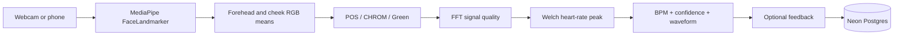

# FaceHealth AI

Contactless **wellness** heart-rate estimate from a short webcam or phone scan.

> **Not a medical device.** Not for diagnosis, screening, or treatment decisions.

**Live demo:** [https://face-health-ai.vercel.app](https://face-health-ai.vercel.app)  
**Repo:** [Monike123/face-health-ai](https://github.com/Monike123/face-health-ai)

---

## What it does

1. You centre your face in the oval and hold still (~30 seconds; slower phones may continue up to ~90 seconds).
2. The **browser** finds face landmarks (MediaPipe) and averages colour on forehead + cheeks.
3. Only those colour averages are sent to the server — **video frames never leave your device**.
4. Classical rPPG (POS / CHROM / Green) estimates BPM, a confidence score, a likely range, and a short waveform.
5. Optional feedback can be stored (see below) to improve the product.

---

## How the pipeline works



| Stage | Where | Detail |
| :--- | :--- | :--- |
| Landmarks + ROI | Browser (`web/`) | Convex-hull forehead / cheeks; downscaled sampling for mobile |
| Pulse extraction | Server + TS mirror | POS, CHROM, and Green — best FFT SQI wins |
| HR estimate | `web/lib/rppg.ts` | Bandpass 0.7–3.0 Hz → Welch PSD → BPM |
| Desktop HUD | Python `src/facehealth` | Same classical path for local research |

Deep learning (PhysNet) exists for **research training** only. The live demo uses classical methods until a trained model beats the POS baseline on held-out data.

---

## Data: what we store

| Data | Stored? | Notes |
| :--- | :---: | :--- |
| Camera frames / face images | No | Stay in the browser |
| Colour-average time series (scan) | Transient | Used to compute HR; not kept unless you opt in |
| Feedback ratings / comments | Yes | Neon table `scan_feedback` |
| Opt-in colour trace | Only if checked | Anonymous JSON; default **off** |
| IP / account id with feedback | No | Open access demo |
| Retention | 12 months | Then delete |

Emails: when Resend is configured, each feedback notifies the operator (metadata only — never the raw trace).  
Privacy page on the live site and ADR-003 document the policy.

---

## Run locally

### Web demo

```powershell
cd web
npm install
npm run dev
```

Open http://127.0.0.1:3000

### Python HUD / research

```powershell
.\.venv\Scripts\Activate.ps1
pip install -e ".[dev]"
pytest -q
python -m facehealth --live
```

### Feedback DB (optional)

```powershell
cd web
vercel env pull .env.local --environment=production
npm run db:migrate
```

Needs `DATABASE_URL` (Neon). Optional: `RESEND_API_KEY` for notify-on-feedback.

---

## Deploy

- **Web:** Vercel project, root directory `web`
- **Python API (optional parity):** `backend/` → e.g. `facehealth-api`

---

## Next plan — models and datasets

Strict order (project rules):

1. Obtain **UBFC-rPPG** (and ideally PURE) under `data/raw/` — request templates in [`docs/datasets/REQUEST_EMAILS.md`](docs/datasets/REQUEST_EMAILS.md).
2. Run classical POS benchmark — release gate **MAE ≤ 2.5 BPM** on UBFC.
3. Subject-wise train/val/test splits — no subject leakage.
4. PhysNet smoke train locally → full train on cloud GPU (e.g. Kaggle) if needed.
5. Ship ONNX / edge weights **only if** DL beats classical POS on the held-out set.

Research-only or gated datasets (MMPD, COHFACE, etc.) must not contaminate commercial weights. See [`docs/datasets/GUIDE.md`](docs/datasets/GUIDE.md) and [`docs/soup_register.md`](docs/soup_register.md).

More product detail: [`docs/PRODUCT.md`](docs/PRODUCT.md). Current status: [`STATUS.md`](STATUS.md).

---

## Roadmap

- [x] Classical POS / CHROM / Green web scan
- [x] Mobile-friendly capture (adaptive length, light scan loop)
- [x] Confidence, range, waveform, feedback → Neon
- [x] Privacy page + wellness copy
- [ ] Operator email (Resend domain or API key)
- [ ] UBFC on disk + classical MAE gate
- [ ] PhysNet train → ONNX if better than POS

---

## License / compliance

Third-party inventory: [`docs/soup_register.md`](docs/soup_register.md).  
Intended use: [`docs/adr/ADR-001-intended-use-wellness.md`](docs/adr/ADR-001-intended-use-wellness.md).
