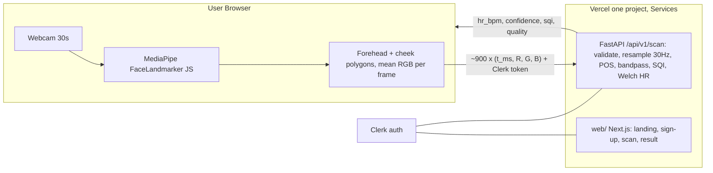

# FaceHealth AI — Web v0.1 Beta Launch Plan

Status: **DRAFT — awaiting user approval before any code is written.**
Owner decisions (locked 2026-11-14): hybrid processing, Clerk auth, store nothing, HR-only result,
ship Beta before M2 (recorded exception), public repo `Monike123/face-health-ai`.

---

## 0. What v0.1 Is (and Is Not)

**Is:** a public website on Vercel where a person signs up, reads a wellness note, gives camera
consent, holds still for a 30-second face scan, and sees an **estimated heart rate** plus a
signal-quality rating. Same classical POS pipeline as today's desktop HUD.

**Is not:** HRV, breathing rate, stress, BP, SpO2, PhysNet/DL output, scan history, mobile app,
medical device. All stay off until their milestones pass their release gates.

### Architecture



- Video **never leaves the device**. Only per-frame colour averages (~30 KB) are sent.
- Nothing is stored server-side. No per-user logs.
- Python DSP is **reused, not rewritten** (`pos_stream`, `bandpass`, `sqi_from_bvp`, `estimate_hr_bpm`).

---

## 1. Timeline (working hours, sequential)

| Phase | Work | Est. | Gate to pass before next phase |
| :--- | :--- | :--- | :--- |
| P0 | Pre-flight: ADR-002, gitignore, secret-scan fix, git init | 0.5 h | `pytest`/`ruff`/`mypy` green, no secrets |
| P1 | Backend: shared `hr_from_rgb`, FastAPI app, auth, tests | 2–3 h | New API tests green |
| P2 | Deploy spike: empty Next.js + `/api/v1/health` on Vercel | 1 h | Both reachable on one `*.vercel.app` URL |
| P3 | Frontend: landing, Clerk pages, scan flow, result | 4–6 h | `npm run build` + lint clean |
| P4 | Local end-to-end test on your laptop | 1–2 h | HR within ±5 BPM of watch, 3 of 3 runs |
| P5 | Push to GitHub, production deploy, phone test | 1 h | Live URL works on laptop + phone |
| P6 | Post-launch hardening + docs update | 1 h | Checklist §8 all ticked |
| **Total** | | **~1.5–2 working days** | |

ML track (§9) runs in parallel when datasets finish downloading; it does **not** block v0.1.

---

## 2. Phase P0 — Pre-flight (agent)

1. `docs/adr/ADR-002-web-beta-before-m2.md`: records the milestone exception (web P32 slice before
   M2), scope limits (HR only, Beta label, no storage), and exit criteria (M2 before v1.0).
2. Update `.cursor/rules/global.mdc` stop condition 6 to reference ADR-002 as the only approved exception.
3. `.gitignore` additions: `web/node_modules/`, `web/.next/`, `.vercel/`,
   `cursor_plan_review_suggestions.md` (chat export, not for a public repo).
4. CI secret scan regex: add Clerk key format `sk_(test|live)_[A-Za-z0-9]{20,}` (current regex only
   catches `sk-`, so a leaked Clerk secret would pass today).
5. Manual PII sweep of files going public (`docs/datasets/REQUEST_EMAILS.md`, `MASTER_PLAN.md`,
   `task_plan.md`, `CURSOR.md`, `ANTIGRAVITY.md`) for personal email/phone/addresses.
6. `git init -b main` (no commit yet).

## 3. Phase P1 — Backend API (agent)

| Step | File | Change |
| :--- | :--- | :--- |
| 1.1 | `src/facehealth/vital_estimation/hr_estimator.py` | Add `hr_from_rgb(rgb, fs, cfg) -> (hr\|None, conf, sqi)`: the exact POS → bandpass → SQI → Welch → gate sequence now inlined in `pipeline.py` lines 66–74 |
| 1.2 | `src/facehealth/pipeline.py` | Replace inline block with `hr_from_rgb` (behaviour unchanged) |
| 1.3 | `src/facehealth/api/app.py` | FastAPI app: `GET /api/v1/health`, `POST /api/v1/scan` |
| 1.4 | `src/facehealth/api/auth.py` | Clerk session verification via official `clerk-backend-api` SDK `authenticate_request`, `authorized_parties` = allowed origins from env |
| 1.5 | `api/index.py` | Thin Vercel entry: puts `src/` on `sys.path`, re-exports `app` (`shortcut:` comment) |
| 1.6 | `requirements.txt` | Becomes **server runtime only** (numpy, scipy, pydantic, PyYAML, fastapi, clerk-backend-api); dev installs keep using `pyproject.toml` |
| 1.7 | `pyproject.toml` | `api` extra gets `clerk-backend-api`, `httpx` (TestClient) |
| 1.8 | `docs/soup_register.md` | Add FastAPI, clerk-backend-api (MIT), MediaPipe Tasks JS, Next.js, @clerk/nextjs |
| 1.9 | `.github/workflows/ci.yml` | Install `.[dev,api]` so API tests run in CI |

### `POST /api/v1/scan` contract (trust boundary — validated with Pydantic)

Request:
```json
{ "t_ms": [0.0, 33.4, ...], "rgb": [[142.1, 98.3, 80.2], ...] }
```
Validation (reject with 422):
- `len(t_ms) == len(rgb)`, 300 ≤ samples ≤ 2400
- `t_ms` strictly increasing, total span 20–40 s, effective fps ≥ 10
- every RGB value finite and in [0, 255]
- body < 100 KB (well under Vercel's 4.5 MB cap)

Processing: resample to uniform 30 Hz with `np.interp` (browsers do not deliver exact 30 fps)
→ `hr_from_rgb` with `AppConfig` loaded from `configs/config.yaml` (defaults if missing, same
pattern as `pipeline.py`).

Response:
```json
{ "hr_bpm": 72.4, "confidence": 0.61, "sqi": 0.58, "quality": "good",
  "message": "Estimate ready.", "disclaimer": "Wellness estimate only. Not a medical device." }
```
`hr_bpm: null`, `quality: "low"`, `message: "Signal too weak. Sit still in even light and retry."` when `sqi < sqi_gate`.

Errors: 401 missing/invalid Clerk token; 422 bad payload; 500 never leaks a stack trace.
Logging: duration, sample count, sqi, latency only. No user id, no RGB arrays.

### Tests (`tests/unit/test_api_scan.py`)
- Synthetic 72 BPM trace with jittered timestamps → `hr_bpm` within ±3 BPM.
- Flat/noise trace → `hr_bpm` is `null`, `quality == "low"`.
- Mismatched lengths, NaN, out-of-range, too short → 422.
- No auth header → 401 (auth dependency overridden in the other tests).
- `tests/unit/test_roi_parity.py`: ROI index arrays in `web/lib/roi.ts` equal `configs/landmark_config.yaml` (stops silent drift between Python and browser).

## 4. Phase P2 — Deploy Spike (agent + you)

Goal: prove the Vercel layout **before** building UI on top of it.

Primary layout — **Vercel Services (Beta)**, one project, same origin, no CORS:
```json
{
  "services": {
    "web": { "root": "web" },
    "backend": { "root": ".", "entrypoint": "api/index.py",
                 "functions": { "api/index.py": { "excludeFiles": "{web/**,data/**,.venv/**,models/**,tests/**,docs/**}" } } }
  },
  "rewrites": [
    { "source": "/api/v1/(.*)", "destination": { "service": "backend" } },
    { "source": "/(.*)", "destination": { "service": "web" } }
  ]
}
```
Steps:
1. Agent: `npx create-next-app@latest web` (TypeScript, App Router, Tailwind, ESLint).
2. You: `npm i -g vercel` then `vercel login` (browser opens).
3. Agent: `vercel deploy` (preview) and curl `/` and `/api/v1/health`.

Fallback if Services rejects root `.` or Python deps resolve wrong: two Vercel projects from the
same repo (`web/` and `.`), frontend calls `NEXT_PUBLIC_API_URL`, FastAPI CORS allowlist =
frontend origin only. Decide here; do not proceed to P3 until one layout is green.

## 5. Phase P3 — Frontend (agent)

Plain, functional UI. No animations, no branding work.

| Route | Access | Content |
| :--- | :--- | :--- |
| `/` | public | Name, one-line purpose, wellness note, "Sign up" / "Sign in" |
| `/sign-up/[[...sign-up]]` | public | Clerk `<SignUp />` (email + Google) |
| `/sign-in/[[...sign-in]]` | public | Clerk `<SignIn />` |
| `/scan` | signed-in only (`proxy.ts` with `clerkMiddleware` + `createRouteMatcher`) | Consent → camera → 30 s scan → result |

### Scan flow (`web/app/scan/page.tsx` + `web/lib/`)
1. **Consent card**: wellness note + privacy note ("video stays on your device; only colour
   averages are sent; nothing is stored"). Checkbox required to continue.
2. **Camera**: `getUserMedia({ video: { width: 640, height: 480, facingMode: "user" } })`.
   Clear messages for permission denied / no camera.
3. **Tracking**: `@mediapipe/tasks-vision` `FaceLandmarker` in `VIDEO` mode; model and WASM loaded
   from Google's pinned CDN URLs (no 3.7 MB model in the repo).
4. **ROI sampling** (`web/lib/roi.ts`): same 3 index lists as `configs/landmark_config.yaml`;
   draw frame to a 320×240 offscreen canvas, rasterise polygons, average RGB of mask pixels,
   record `performance.now()` per frame via `requestVideoFrameCallback`.
5. **UX during scan**: 30 s countdown + progress bar, ROI outline overlay, live hints
   ("Face not found", "Hold still"). If no face for > 20 % of frames → stop and ask to retry.
6. **Submit**: `fetch("/api/v1/scan", { Authorization: Bearer <Clerk getToken()> })`.
7. **Result card**: "Estimated heart rate: 72 BPM", quality badge (Good / Low), short
   disclaimer, "Scan again". Low quality shows the retry tip, not a number.
8. Camera tracks stopped on result, on navigation away, and on error.

### Copy rules (ADR-001)
Use: "estimated", "wellness", "for general fitness and relaxation awareness".
Never use: "diagnose", "detect disease", "medical", "clinical", "accurate as a pulse oximeter".
Footer on every page: "FaceHealth AI Beta is a wellness tool, not a medical device."

### Security headers (`web/next.config.ts`)
`Permissions-Policy: camera=(self)`, `X-Content-Type-Options: nosniff`,
`Referrer-Policy: strict-origin-when-cross-origin`. Dev-only rewrite `/api/v1/*` →
`http://127.0.0.1:8000` so local testing needs no Vercel CLI.

## 6. Phase P4 — Local Test (you, with agent)

Two terminals:
```powershell
# Terminal 1 — backend
.\.venv\Scripts\Activate.ps1
pip install -e ".[dev,api]"
uvicorn facehealth.api.app:app --port 8000 --reload --app-dir src

# Terminal 2 — frontend
cd web
npm install
npm run dev     # open http://localhost:3000
```
Test script (record results in `tasks/todo.md`):
1. Sign up with a new email → lands on `/scan`.
2. Deny camera → friendly error. Allow → face outline appears.
3. Three 30 s scans sitting still, compare with smartwatch/pulse oximeter: pass if within ±5 BPM.
4. One scan while talking/moving → expect "Low quality" rather than a wild number.
5. Cover face mid-scan → "Face not found" retry.
6. Sign out → `/scan` redirects to sign-in.
7. DevTools Network tab: confirm request body has only `t_ms` + `rgb`, no image data.

## 7. Phase P5 — Publish (agent + you)

1. Agent: final gates — `pytest -q`, `ruff check src tests`, `mypy src/facehealth`,
   `npm run lint`, `npm run build`, secret scan, `git status` review of every staged file.
2. Agent: first commit, `gh repo create Monike123/face-health-ai --public --source . --push`,
   tag `v0.1.0-beta`.
3. You: Vercel dashboard → Import `face-health-ai` from GitHub (auto-deploy on every push to `main`).
4. You: add env vars in Vercel (Production + Preview):
   `NEXT_PUBLIC_CLERK_PUBLISHABLE_KEY`, `CLERK_SECRET_KEY`, `ALLOWED_ORIGINS`
   (e.g. `https://face-health-ai.vercel.app`). Or install the Clerk integration from the Vercel Marketplace.
5. You: Clerk dashboard → add the Vercel URL as an allowed origin; enable Email + Google sign-up.
6. Agent: smoke test live URL (`/`, `/api/v1/health`, sign-up page loads).
7. You: run the P4 test script once on laptop and once on your phone (HTTPS works on phone).

**Known limitation:** Clerk **production** keys require a domain you own. v0.1 Beta runs on the
Clerk **development** instance on `*.vercel.app` (shows a small "Development mode" badge, fine for
Beta). Buy/attach a domain before v1.0 to switch to production keys.

## 8. Phase P6 — Post-launch Checklist

- [ ] Vercel Firewall rate-limit rule on `/api/v1/scan` (e.g. 10 requests/min per IP) — dashboard, 2 min
- [ ] No secrets in repo (`git log -p | Select-String "sk_"` empty)
- [ ] `STATUS.md`, `task_plan.md` (P29/P31/P32 partial), `CURSOR.md`, `README.md` updated with live URL and web commands
- [ ] `tasks/todo.md` review section: what shipped, test results, open risks
- [ ] GitHub release notes for `v0.1.0-beta` with the wellness disclaimer

## 9. ML Track (parallel, after datasets finish downloading)

Strict order — each step gates the next:
1. You: tell me which datasets landed and where (`data/raw/<NAME>/`).
2. Verify: `python scripts/datasets/verify_dataset.py --name ubfc` (and `pure`).
3. Classical scoreboard: full 42-subject UBFC POS + CHROM MAE (Release Gate ≤ 2.5 BPM).
   Upgrade `benchmark_pos.py` from 10 s clips to full-length + per-subject report.
4. M2 robustness (soft motion weights, illumination notch, fuller SQA) → re-benchmark; ship to web as v0.2 if MAE improves (same API, no frontend change).
5. Subject-wise splits + real-data loader for PhysNet (UBFC/PURE only for anything shippable).
6. Local smoke train on RTX 3050 (AMP, small batch) → full train on cloud GPU.
7. Compare PhysNet vs POS on held-out subjects + cross-dataset. Only if PhysNet beats POS:
   ONNX export → backend switches `extractor` (needs face-crop video, so a v0.3 design change —
   planned separately; classical POS stays the web default until then).

## 10. What You Need To Do (summary)

| When | Action | Time |
| :--- | :--- | :--- |
| Now | Approve this plan (or edit it) | 5 min |
| P2 | `npm i -g vercel` + `vercel login` | 5 min |
| P3 | Create free Clerk account + app (email + Google) and paste the two keys into `web/.env.local` | 10 min |
| P4 | Run the local test script (3 still scans vs watch) | 20 min |
| P5 | Import repo in Vercel, add 3 env vars, add Vercel URL in Clerk | 15 min |
| P5 | Test on phone | 5 min |
| Anytime | Tell me when datasets finish downloading | — |

## 11. Risks

| Risk | Impact | Mitigation |
| :--- | :--- | :--- |
| Vercel Services is Beta; root `.` + Python packaging unproven for this repo | Deploy blocked | P2 spike first; two-project fallback ready |
| Browser webcams auto-adjust exposure/white balance | Noisy HR | SQI gate shows "Low quality" instead of a wrong number; M2 work |
| HR accuracy unvalidated on real datasets | Misleading numbers | "Estimated", Beta label, wellness copy, no claims |
| Abuse of public API | Cost | Clerk auth required + Vercel rate-limit rule |
| MediaPipe CDN outage | Scan fails | Pinned version; self-host model later if seen |
| No CSP header in v0.1 (MediaPipe WASM needs `wasm-unsafe-eval`) | Lower XSS defence | Add CSP in v0.2 after testing |
| `mediapipe` (`.[ml]`) pulls `opencv-contrib-python` alongside `opencv-python` | Local env conflict | Pre-existing; untouched in v0.1, fix in M2 |
